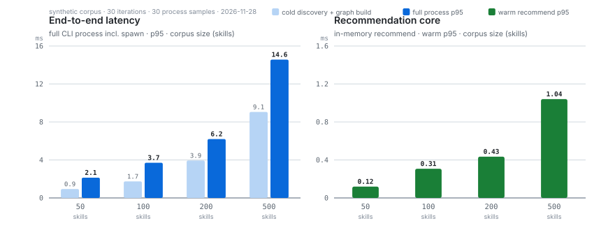
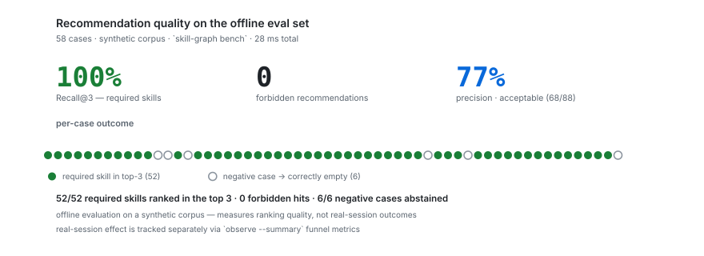
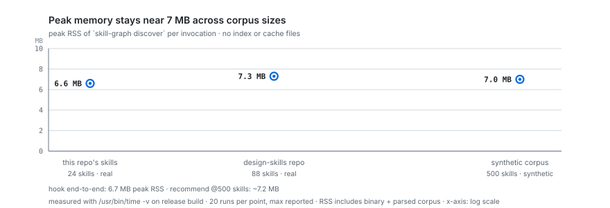
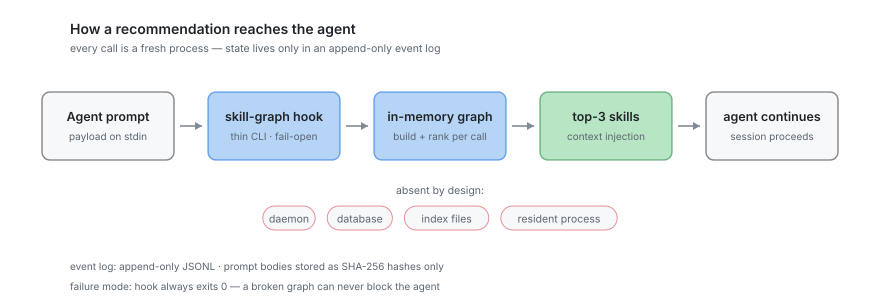

# skill-graph

Agent Skills の発見・参照解決・推薦を支援する、エージェント非依存の CLI
ツール。標準の Agent Skills を変更せず、導入済みスキルの `SKILL.md`、
Markdown リンク、frontmatter、作業コンテキストから必要なスキルへ到達
できるようにする。

対応ランタイム: **Claude Code / Codex / OpenCode**（opt-in adapter）。

## 実測パフォーマンスと品質

以下は release build の実測値。測定環境・コーパス・測定条件・再現コマンドは
[docs/evidence/2026-11-27-v050-readme-perf-eval.md](docs/evidence/2026-11-27-v050-readme-perf-eval.md)
に記録した。図は `assets/readme/` の SVG で、`scripts/gen-readme-assets.py`
が実測 JSON（`assets/readme/data/`）から light/dark 両テーマを再生成する。

### レイテンシとスケーラビリティ

<picture>
  <source media="(prefers-color-scheme: dark)" srcset="assets/readme/perf-latency-dark.svg">
  
</picture>

合成コーパス 50→500 skills で計測（warm は 30 iterations、process は
30 samples の p95）。推薦コア（warm recommend）は p95 約 1.1ms、
プロセス起動を含む end-to-end でも 500 skills で p95 約 16.6ms。コールド
スタートを含む discovery + グラフ構築はほぼ線形で、500 skills でも
約 12.5ms に収まる。

### 推薦品質

<picture>
  <source media="(prefers-color-scheme: dark)" srcset="assets/readme/eval-quality-dark.svg">
  
</picture>

オフライン評価セット（58 cases・合成コーパス）で Recall@3 = 52/52、
forbidden recommendation = 0、ネガティブケース 6/6 で適切に推薦を棄権した。
これはランキング品質の測定であり、実セッションでの推薦→読込→変換効果は
`observe --summary` の funnel 指標で別途計測する（合成評価と実利用の
効果測定は区別する）。

### メモリとフットプリント

<picture>
  <source media="(prefers-color-scheme: dark)" srcset="assets/readme/perf-memory-dark.svg">
  
</picture>

ピーク RSS は 6.3〜7.4MB（実コーパス 24/88 skills、本文量を揃えた
合成コーパス 50/100/200/500 skills を各 20 回計測した最大値）。
規模増加に対する増加は緩やかで、インデックス・キャッシュ・常駐
プロセスを持たないため、コストは呼び出しごとのプロセス起動に
限定される。

### アーキテクチャ

<picture>
  <source media="(prefers-color-scheme: dark)" srcset="assets/readme/architecture-dark.svg">
  
</picture>

## Install

パッケージマネージャから導入する。hook の有効化は install では行われず、
後述の `skill-graph adapter enable` で明示的に opt-in する。

**利用可能なチャネルは mise（`github:` backend）・Homebrew・npm・
crates.io の4系統。** v0.5.0 は npm / crates.io を含む全チャネルで
正式公開するバージョン（v0.4.0 時点では npm / crates.io が未公開だった）。

### mise（推奨・動作保証チャネル）

```bash
mise use -g github:rebuildup/skill-graph          # 最新版
mise use -g github:rebuildup/skill-graph@0.5.0   # バージョン固定
```

GitHub Release のバイナリ tarball を直接取得するため、外部レジストリの
公開状態に依存しない。clean environment での導入はこの経路を保証する。

### Homebrew

```bash
brew install rebuildup/tap/skill-graph
```

`rebuildup/homebrew-tap` の formula が v0.5.0 release asset を参照する
（`on_macos`/`on_linux` × Intel/ARM）。

### npm / Bun / pnpm

```bash
npm install -g @rebuildup/skill-graph
bun add -g @rebuildup/skill-graph
pnpm add -g @rebuildup/skill-graph
```

パッケージ定義は `npm/` にあり、platform 別バイナリを optional
dependency として同梱する設計（postinstall のダウンロード・ビルドなし）。

### crates.io

```bash
cargo install skill-graph
```

ソースからビルドする場合（Rust toolchain は `rust-toolchain.toml` 参照）:

```bash
git clone https://github.com/rebuildup/skill-graph && cd skill-graph
cargo build --release   # -> target/release/skill-graph
```

### 対応プラットフォーム

Linux x86_64/ARM64 (glibc, WSL2 含む)、macOS x86_64/ARM64。
Windows は WSL2 経由。musl・Windows native は対象外。

最低バージョン（#225 F10 — 全て CI の実ビルド環境に一致）:

- **Linux**: Ubuntu 24.04 系でビルドした glibc 動的バイナリのため
  **glibc 2.39 以上**を要求する（それより古い distro では
  `cargo install` によるソースビルドを使う）。
- **macOS**: macOS 15 以降（CI は macos-15 runner でビルド・
  ネイティブ実行検証）。
- **Node.js**（npm shim のみ — バイナリ自体は Node 不要）:
  `engines: >=14.18` を宣言。CI の実測は Node 22 であり、それ未満
  の floor は未検証。
- **Rust**（cargo install / crates.io のソースビルド）: MSRV
  **1.89**（`Cargo.toml` の `rust-version`、CI の msrv job が
  同一 toolchain で check+test を実施。#225 F11 の依存脆弱性
  修正で rusqlite 0.43 / libsqlite3-sys 0.40 へ更新した際に
  引き上げ）。

Windows native で `npm install @rebuildup/skill-graph` を実行すると、
win32 向け optional package が存在しないため os/cpu gating により
インストールが失敗する。これは意図した診断であり、Windows では
WSL2 内で導入・実行する。ソースからのビルドも Windows native は
サポート対象外（動作未検証）である。

## CLI

```bash
skill-graph discover [--root <dir>]...                  # スキル列挙
skill-graph search <query> [--root ...]                  # キーワード検索
skill-graph recommend <query> [--root ...]               # 推薦（--format json）
skill-graph resolve <target> [--root ...]                # 名前/リンク解決
skill-graph observe <path> [--summary]                     # transcript/DB/イベントログの観測集計（--summary で funnel 指標）
skill-graph detect --runtime <rt> --via <via>            # hook/plugin 用イベント正規化（stdin）
                                                         # --via 既定値は "hook"。有効値: hook|plugin|transcript|db
skill-graph hook <claude-code|codex|opencode> <prompt|skill-load> # ランタイム hook 入口（stdin、fail-open）
skill-graph mcp                                          # stdio MCP server（read-only tools）
skill-graph adapter <enable|disable|status> <rt>         # adapter ライフサイクル管理
skill-graph bench <dataset> / perf                       # 評価・性能ハーネス
```

既定の探索 root: `~/.claude/skills`、`~/.agents/skills`、`./skills`、
`./.claude/skills`、`./.agents/skills` 等。root の解決は全入口で共通:
`SKILL_GRAPH_ROOTS`（colon 区切り）が設定されていれば **常に最優先**
（`--root` や MCP tool の `roots` より優先される）→ 明示引数 →
既定 root の順。`--root` は env 未設定時の上書きとして使う。
永続キャッシュ・daemon・PATH 変更は行わない。

## MCP server

`skill-graph mcp` は stdio トランスポートの MCP server。CLI と同一の
Discovery → Resolver → Recommendation エンジンを read-only tool として
公開する（ADR-0005）。tool は `recommend` / `discover` / `resolve` の
3 つで、状態変更・イベント書き込みは行わない。

```bash
skill-graph mcp   # stdio。JSON-RPC を stdin/stdout で話す
```

各クライアントの MCP 設定例（`command` はインストール済み
`skill-graph` のパス）:

```jsonc
// Claude Code: ~/.claude.json またはプロジェクト .mcp.json
{ "mcpServers": { "skill-graph": { "command": "skill-graph", "args": ["mcp"] } } }

// OpenCode: opencode.json
{ "mcp": { "skill-graph": { "type": "local", "command": ["skill-graph", "mcp"] } } }

// Codex: ~/.codex/config.toml
[mcp_servers.skill-graph]
command = "skill-graph"
args = ["mcp"]
```

`observe --summary` は observation-pilot の funnel 指標
（delivery / conversion / unnecessary-load / timeliness / context
consumption、runtime 別内訳つき）を算出する。

## Runtime adapters（opt-in）

`skill-graph adapter` がランタイムのネイティブ設定へ hook/plugin を
**絶対パス・冪等 merge** で追加する。PATH・shell rc・無関係な設定は
変更しない。`--user`（既定）/ `--project`（カレントプロジェクト）を選択可。

```bash
skill-graph adapter enable  claude-code
skill-graph adapter enable  codex
skill-graph adapter enable  opencode
skill-graph adapter status  claude-code   # enabled/disabled/broken + legacy 検出通知
skill-graph adapter disable claude-code   # 追加エントリのみ除去・完全復元
```

| Runtime | Mechanism | 備考 |
|---|---|---|
| claude-code | `settings.json` hooks（UserPromptSubmit / PostToolUse `Skill`） | hook コマンドは `<bin> hook claude-code <mode>` |
| codex | `hooks.json`（UserPromptSubmit / PostToolUse `Bash`） | 初回は Codex TUI の `/hooks` で trust が必要（通常導入経路） |
| opencode | `opencode.json` `plugins` → 同梱 TS plugin | `file://` specifier、plugin は `~/.local/share/skill-graph/opencode-plugin/` に materialize |

hook コマンドには enable 時に PATH 解決した `skill-graph` の絶対パスを
埋め込む。mise shim・npm global bin・brew のいずれのパスでも動作する。
明示指定は `--bin <path>`（opencode は plugin が `SKILL_GRAPH_BIN` /
PATH で解決するため `--bin` は使えない）。PATH 上の候補は `hook`
サブコマンド対応を実際に probe するため、v0.3.x の古いバイナリが
先に見つかっても埋め込まれない。

### 挙動

- prompt 受付時に関連スキルを推薦し `additionalContext`（または
  OpenCode の system context）として注入。
- SKILL.md の実読み込みを検出すると `skill_load` イベントを発行し、
  宣言された依存スキルを追加推薦。
- すべて fail-open: バイナリ不在・内部エラーでもセッションをブロック
  しない（hook は常に exit 0、plugin は spawn 失敗を握りつぶす）。
  パッケージ削除後に壊れた hook が残っても runtime の通常動作は妨げない。
- イベントは `${TMPDIR}/skill-graph-events.jsonl`（JSONL）へ。
  prompt は SHA-256 hash のみで本文・コマンド・tool response は
  **一切保存しない**。
- `skill-graph hook`（claude-code / codex / opencode）が参照する環境変数:
  `SKILL_GRAPH_EVENT_LOG` で保存先変更、`SKILL_GRAPH_HOOK_NOSTATE=1`
  で全書き込み無効化（state marker も生成しない no-save mode）、
  `SKILL_GRAPH_EVENT_LOG_MAX`（既定 64MiB）でローテーション。
- OpenCode plugin も `SKILL_GRAPH_EVENT_LOG`・`SKILL_GRAPH_ROOTS`・
  `SKILL_GRAPH_BIN`・`SKILL_GRAPH_HOOK_NOSTATE`・
  `SKILL_GRAPH_EVENT_LOG_MAX` を hook と同じ規約で参照する
  （NOSTATE で全イベント書き込み停止、上限超過で `.1` へ
  ローテーション）。recommend の query は stdin 経由
  （`--query-stdin`）で、prompt 本文は argv に載らない。

## Update / Uninstall

- **更新**: 各パッケージマネージャの通常手順（`mise upgrade`、
  `brew upgrade`、公開後は `npm install -g @rebuildup/skill-graph@latest`、
  `cargo install --force`）。hook コマンドのパスが変わらない限り
  adapter の再 enable は不要。パスが変わった場合は
  `adapter disable && adapter enable` で張り替える。
- **無効化（一時）**: `SKILL_GRAPH_HOOK_NOSTATE=1` でイベント書き込み停止
  （`skill-graph hook` と OpenCode plugin の両経路に適用される）。
- **adapter のみ無効化**: `skill-graph adapter disable <rt>`。
  追加したエントリのみ除去し、他の hook/plugin・設定は保持。
  `{}` まで減った設定ファイルは削除される（symlink 管理の設定は
  リンクを残して target に `{}` を書き込む）。
- **完全削除**: パッケージマネージャの uninstall に加え、事前に
  `adapter disable` を実行して hook/plugin 参照を除去する
  （残っても fail-open だが、設定を清潔に保つため推奨）。

## v0.3.x からの移行

v0.3.x の `install.sh` / `adapters/install.sh` で導入した環境は、
新版インストール後に一度だけ移行する:

```bash
skill-graph adapter enable <rt>     # 旧 skill-graph-recommend-hook /
                                     # /skill-graph plugin 参照を自動検出・除去して置き換え
skill-graph adapter status <rt>     # enabled を確認後、旧配置を削除
skill-graph adapter clean-legacy    # v0.3.x の install home 残存物
                                     # (current symlink・<semver>/・
                                     # ~/.local/bin/skill-graph) のみ除去。
                                     # 新しい opencode-plugin/ payload は保持
```

Codex の `/hooks` trust はコマンド文字列の hash-pin のため、移行で
コマンドが変わると **一度だけ再 trust が必要**（ユーザー操作）。

## Privacy

- 保存するのは `contracts/v1/skill-usage-event.schema.json` のイベント
  のみ。会話本文・コマンド・tool response は永続化しない。
- transcript / `opencode.db` の解析は read-only。`observe` はソースを
  変更しない。
- 既定の保存先は `${TMPDIR}`（揮発領域）のみ。永続的な観測が必要な場合は
  `SKILL_GRAPH_EVENT_LOG` にユーザー指定パスを明示する（opt-in）。

## Known limitations

- macOS バイナリは提供するが実機検証は限定的。
- Codex の skill-load 検出は `PostToolUse` matcher `Bash` のコマンド分類
  （Codex に Skill tool は存在しない）。
- bun は os/cpu gating を適用しないため全 platform package を取得する
  （shim が正しい arch を選択するため動作上の問題はない）。
- 永続キャッシュ・Embedding・グラフDB は意図的に未実装（v1.0.0 spec で
  非採用を確定。MCP server は実装済み）。
- マーカー（`# skill-graph-managed`）を持たない `hook <rt> <mode>`
  形式のコマンドは、bin 名が `skill-graph` の場合のみ自動認識される。
  手動編集や開発版で書かれた独自名バイナリの hook は `status` で
  disabled と表示されるため、手動除去するか marker 付きで
  `adapter enable` を再実行する。

## Development

`AGENTS.md`（開発契約）、`docs/specs/`（仕様・評価・pilot 計画）、
`docs/evidence/`（実測記録）、`docs/adr/`（設計判断）が正本。
品質ゲート: `mise run check`（fmt + clippy + test）。
